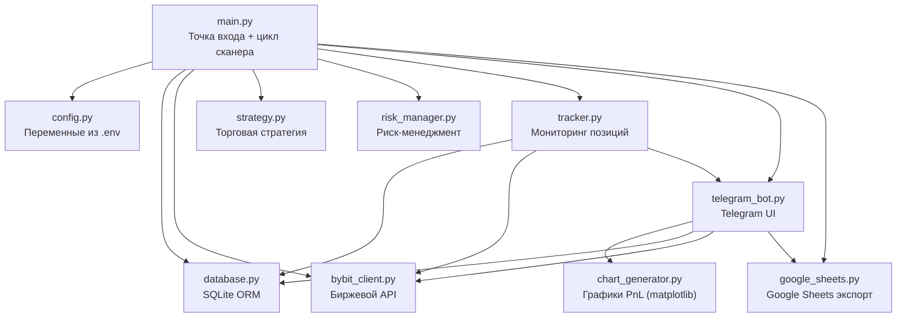

# 📘 Инструкция: Как написать Telegram-бота торговой системы (по модели AntiGravity 2.0)

> **Цель:** Создать с нуля Telegram-бота с полным управлением торговым процессом, включая меню, inline-кнопки, интеграцию с биржей, БД, Google Sheets и графики PnL.

---

## 📐 Архитектура проекта



### Файловая структура проекта
```
my_bot/
├── main.py              # Точка входа, asyncio event loop
├── config.py            # Загрузка переменных из .env
├── database.py          # SQLite: таблицы signals, trades, settings
├── bybit_client.py      # HTTP/WebSocket клиент биржи (pybit)
├── strategy.py          # Алгоритм поиска сигналов
├── indicators.py        # Технические индикаторы (EMA, RSI, ATR)
├── risk_manager.py      # Проверка лимитов, расчёт размера ордера
├── tracker.py           # Фоновый мониторинг позиций (каждые 12 сек)
├── telegram_bot.py      # Telegram UI: меню, команды, inline-кнопки
├── chart_generator.py   # Генерация PNG-графиков PnL
├── google_sheets.py     # Экспорт в Google Таблицу
├── requirements.txt     # Зависимости Python
├── Dockerfile           # Docker-образ
├── docker-compose.yml   # Запуск контейнера
├── deploy.sh            # Скрипт деплоя
├── .env.example         # Шаблон переменных окружения
├── .env                 # Реальные ключи (НЕ в git)
└── google_creds.json    # Service Account Google (НЕ в git)
```

---

## 🔨 Пошаговый план разработки

### Шаг 1. Конфигурация (`config.py`)

Все параметры загружаются из `.env` через `python-dotenv`:

```python
import os
from dotenv import load_dotenv
load_dotenv()

# API keys
BYBIT_API_KEY = os.getenv("BYBIT_API_KEY", "")
BYBIT_API_SECRET = os.getenv("BYBIT_API_SECRET", "")

# Telegram
TELEGRAM_BOT_TOKEN = os.getenv("TELEGRAM_BOT_TOKEN", "")
TELEGRAM_CHAT_ID = os.getenv("TELEGRAM_CHAT_ID", "")
DISABLE_TELEGRAM = os.getenv("DISABLE_TELEGRAM", "False").lower() == "true"

# Google Sheets
GOOGLE_SHEET_ID = os.getenv("GOOGLE_SHEET_ID", "")
GOOGLE_CREDS_FILE = os.getenv("GOOGLE_CREDS_FILE", "google_creds.json")

# Trading parameters
LEVERAGE = int(os.getenv("LEVERAGE", "1"))
MAX_ACTIVE_COINS = int(os.getenv("MAX_ACTIVE_COINS", "3"))
TP1_PCT = float(os.getenv("TP1_PCT", "0.015"))      # +1.5%
TP2_PCT = float(os.getenv("TP2_PCT", "0.035"))      # +3.5%
MAX_SL_PCT = float(os.getenv("MAX_SL_PCT", "0.018"))
MAX_DAILY_LOSS_PCT = 0.05  # 5% of deposit

# Database
DATABASE_PATH = "data/antigravity.db"
```

---

### Шаг 2. База данных (`database.py`)

**Паттерн:** Класс `DatabaseManager` с `sqlite3.Row` для dict-like доступа к данным.

```python
import sqlite3, os, logging
from config import DATABASE_PATH

class DatabaseManager:
    def __init__(self, db_path: str = DATABASE_PATH):
        self.db_path = db_path
        os.makedirs(os.path.dirname(self.db_path), exist_ok=True)
        self._init_db()

    def _get_connection(self) -> sqlite3.Connection:
        conn = sqlite3.connect(self.db_path, timeout=15.0)
        conn.row_factory = sqlite3.Row  # <-- allows dict(row) access
        return conn

    def _init_db(self):
        with self._get_connection() as conn:
            conn.execute("""
                CREATE TABLE IF NOT EXISTS trades (
                    id INTEGER PRIMARY KEY AUTOINCREMENT,
                    order_link_id TEXT UNIQUE NOT NULL,
                    timestamp DATETIME DEFAULT CURRENT_TIMESTAMP,
                    symbol TEXT NOT NULL,
                    side TEXT NOT NULL,       -- 'Buy' (LONG) or 'Sell' (SHORT)
                    qty REAL NOT NULL,
                    entry_price REAL NOT NULL,
                    tp1_price REAL DEFAULT 0.0,
                    tp2_price REAL DEFAULT 0.0,
                    stop_loss REAL,
                    result REAL DEFAULT 0.0,  -- cumulative PnL in USDT
                    status TEXT DEFAULT 'OPEN',
                    tp1_filled INTEGER DEFAULT 0,
                    sl_moved_to_be INTEGER DEFAULT 0,
                    max_drawdown REAL DEFAULT 0.0,
                    note TEXT
                )
            """)
            conn.commit()
```

**Ключевые методы:**
| Метод | Назначение |
|-------|-----------|
| `log_trade(...)` | Записать новую сделку (`status='OPEN'`) |
| `close_trade(link_id, pnl, status)` | Закрыть (`CLOSED_TP2`, `CLOSED_MANUAL`, `CLOSED_SL`, `CLOSED_PANIC`) |
| `mark_tp1_filled_and_be(...)` | TP1 исполнен, обновить qty, PnL, перенести SL |
| `get_open_trades()` | Все `OPEN` / `PARTIAL_TP1` сделки (list[dict]) |
| `get_today_pnl()` | Сумма PnL за сегодня |
| `get_overall_stats()` | `{total_closed, total_pnl, win_rate, max_win, max_loss}` |
| `get_all_trades_for_export()` | Все сделки для экспорта в Sheets |

---

### Шаг 3. Telegram-бот (`telegram_bot.py`) — САМЫЙ ВАЖНЫЙ ФАЙЛ

#### 3.1. Базовая структура класса

```python
import logging, threading
from telebot import TeleBot
from telebot.types import (
    Message, CallbackQuery,
    ReplyKeyboardMarkup, KeyboardButton,
    InlineKeyboardMarkup, InlineKeyboardButton
)
from config import TELEGRAM_BOT_TOKEN, TELEGRAM_CHAT_ID, DISABLE_TELEGRAM
from database import DatabaseManager
from bybit_client import BybitClient

logger = logging.getLogger("TelegramBot")

class TelegramNotifier:
    def __init__(self, db: DatabaseManager, client: BybitClient, sheets_exporter=None):
        self.db = db
        self.client = client
        self.sheets_exporter = sheets_exporter
        self.bot_token = TELEGRAM_BOT_TOKEN
        self.chat_id = TELEGRAM_CHAT_ID
        self.is_configured = bool(self.bot_token and self.chat_id and not DISABLE_TELEGRAM)
        self.is_paused = False
        self.trade_mode = "AUTO"  # "AUTO", "LONG_ONLY", "SHORT_ONLY"

        if not self.is_configured:
            return

        self.bot = TeleBot(self.bot_token, parse_mode="HTML")
        self._register_handlers()

        # Daemon thread — won't block main loop
        self.poll_thread = threading.Thread(target=self._start_polling, daemon=True)
        self.poll_thread.start()
```

#### 3.2. Polling с автоматическим перезапуском

```python
    def _start_polling(self):
        import time
        while True:
            try:
                self.bot.infinity_polling(logger_level=logging.ERROR)
                break
            except Exception as e:
                logger.error(f"Polling error: {e}. Restart in 15s...")
                time.sleep(15)
```

> **Важно:** `infinity_polling()` блокирующий, поэтому работает в daemon-потоке. При ошибке (429, timeout) — автоматический рестарт.

#### 3.3. Авторизация — проверка chat_id

```python
    def _is_auth(self, message: Message) -> bool:
        """Only process messages from the authorized chat."""
        return str(message.chat.id) == str(self.chat_id)
```

> **Паттерн:** Каждый обработчик начинается с `if not self._is_auth(msg): return`.

#### 3.4. ReplyKeyboard — Постоянное меню (кнопки внизу экрана)

```python
    def _get_menu_keyboard(self) -> ReplyKeyboardMarkup:
        markup = ReplyKeyboardMarkup(resize_keyboard=True)
        markup.row(KeyboardButton("💼 Открытые сделки"), KeyboardButton("💰 Баланс"))
        markup.row(KeyboardButton("📊 Статистика"),      KeyboardButton("🏆 Топ монет"))
        markup.row(KeyboardButton("⚙️ Настройки"),       KeyboardButton("🚨 Закрыть всё"))
        markup.row(KeyboardButton("🔄 Синхронизация Sheets"), KeyboardButton("⚙️ Статус"))
        # markup.row(KeyboardButton("📈 График PnL"))  # Optional: chart button
        return markup
```

> **Принцип:** `ReplyKeyboardMarkup` — постоянные кнопки, заменяют клавиатуру. `resize_keyboard=True` — компактное отображение.

#### 3.5. Регистрация обработчиков команд

```python
    def _register_handlers(self):

        # ── /start — главное меню ──
        @self.bot.message_handler(commands=['start', 'menu'])
        def cmd_start(msg: Message):
            if not self._is_auth(msg): return
            self.bot.send_message(
                msg.chat.id,
                "🤖 <b>Bot активен!</b>\nВыберите действие:",
                reply_markup=self._get_menu_keyboard()
            )

        # ── /balance — баланс ──
        @self.bot.message_handler(commands=['balance'])
        def cmd_balance(msg: Message):
            if not self._is_auth(msg): return
            bal = self.client.get_spot_balance_usdt()
            self.bot.send_message(msg.chat.id, f"💰 <b>Баланс:</b> {bal:.2f} USDT")

        # ── /pause, /resume — управление сканером ──
        @self.bot.message_handler(commands=['pause'])
        def cmd_pause(msg: Message):
            if not self._is_auth(msg): return
            self.is_paused = True
            self.bot.send_message(msg.chat.id, "⏸ <b>Бот на паузе.</b>")

        @self.bot.message_handler(commands=['resume'])
        def cmd_resume(msg: Message):
            if not self._is_auth(msg): return
            self.is_paused = False
            self.bot.send_message(msg.chat.id, "▶️ <b>Бот возобновил работу.</b>")

        # ── /stats — статистика торговли ──
        @self.bot.message_handler(commands=['stats'])
        def cmd_stats(msg: Message):
            if not self._is_auth(msg): return
            today_pnl = self.db.get_today_pnl()
            stats = self.db.get_overall_stats()
            text = (
                f"📊 <b>Статистика:</b>\n\n"
                f"Сегодня: <b>{today_pnl:+.2f} USDT</b>\n"
                f"Всего закрыто: <b>{stats['total_closed']}</b>\n"
                f"WinRate: <b>{stats['win_rate']:.1f}%</b>\n"
                f"Общий PnL: <b>{stats['total_pnl']:+.2f} USDT</b>\n"
                f"Лучшая: +{stats['max_win']:.2f} | Худшая: {stats['max_loss']:.2f}"
            )
            self.bot.send_message(msg.chat.id, text)
```

#### 3.6. Список открытых позиций с inline-кнопками управления

```python
        # ── /open — открытые позиции ──
        @self.bot.message_handler(commands=['open'])
        def cmd_open(msg: Message):
            if not self._is_auth(msg): return
            trades = self.db.get_open_trades()
            if not trades:
                self.bot.send_message(msg.chat.id, "📉 Нет открытых сделок.")
                return

            for t in trades:
                sym = t['symbol']
                entry_p = t['entry_price']
                side = t['side']
                link_id = t['order_link_id']

                cur_p = self.client.get_ticker_price(sym)
                direction = 1.0 if side == 'Buy' else -1.0
                pnl = (cur_p - entry_p) * t['qty'] * direction

                icon = "🟢 LONG" if side == 'Buy' else "🔴 SHORT"
                text = (
                    f"{'🟢' if pnl >= 0 else '🔴'} <b>{sym} ({icon})</b>\n"
                    f"Вход: <b>${entry_p:.5f}</b> → Сейчас: <b>${cur_p:.5f}</b>\n"
                    f"💵 PnL: <b>{pnl:+.2f} USDT</b>"
                )

                # Inline buttons for quick trade management
                markup = InlineKeyboardMarkup()
                markup.row(
                    InlineKeyboardButton("🛡 В безубыток", callback_data=f"be_{link_id}"),
                    InlineKeyboardButton("🎯 Забрать 50%", callback_data=f"part_{link_id}")
                )
                markup.row(
                    InlineKeyboardButton("❌ Закрыть", callback_data=f"close_{link_id}"),
                    InlineKeyboardButton("📈 График", url=f"https://www.bybit.com/trade/usdt/{sym}")
                )
                self.bot.send_message(msg.chat.id, text, reply_markup=markup)
```

> **Паттерн:** `InlineKeyboardButton` с `callback_data` — для действий внутри бота. С `url` — для внешних ссылок.

#### 3.7. Callback-обработчики (inline-кнопки)

```python
        # ── Callback: Перенос SL в безубыток ──
        @self.bot.callback_query_handler(func=lambda c: c.data.startswith("be_"))
        def callback_be(call: CallbackQuery):
            if str(call.message.chat.id) != str(self.chat_id): return
            link_id = call.data.replace("be_", "")
            self.bot.answer_callback_query(call.id, "Переношу стоп в БУ...")

            # ... find trade, calculate BE price, execute on exchange ...
            self.client.move_sl_to_be(sym, be_price)
            self.db.mark_be_activated(link_id, be_price)
            self.bot.send_message(call.message.chat.id, f"🛡 <b>SL перенесён в БУ!</b>")

        # ── Callback: Частичное закрытие (50%) ──
        @self.bot.callback_query_handler(func=lambda c: c.data.startswith("part_"))
        def callback_part(call: CallbackQuery):
            # ... close 50%, move SL to BE, update DB ...

        # ── Callback: Полное закрытие ──
        @self.bot.callback_query_handler(func=lambda c: c.data.startswith("close_"))
        def callback_close(call: CallbackQuery):
            # ... cancel TP orders, close by market, update DB ...

        # ── Callback: Смена режима торговли ──
        @self.bot.callback_query_handler(func=lambda c: c.data.startswith("mode_"))
        def callback_mode(call: CallbackQuery):
            new_mode = call.data.replace("mode_", "")
            self.trade_mode = new_mode
            self.bot.answer_callback_query(call.id, f"Режим: {new_mode}")

        # ── Callback: Паника — подтверждение ──
        @self.bot.callback_query_handler(func=lambda c: c.data == "panic_confirm")
        def callback_panic_confirm(call: CallbackQuery):
            # ... close ALL positions, set is_paused = True ...

        @self.bot.callback_query_handler(func=lambda c: c.data == "panic_cancel")
        def callback_panic_cancel(call: CallbackQuery):
            self.bot.send_message(call.message.chat.id, "✅ Отменено.")
```

> **Важно:** `self.bot.answer_callback_query(call.id, "...")` — обязательно вызывать, чтобы убрать «часики» на кнопке.

#### 3.8. Маршрутизация текстовых кнопок меню

```python
        # ── Catch-all: route text buttons to commands ──
        @self.bot.message_handler(func=lambda m: True)
        def handle_text(msg: Message):
            if not self._is_auth(msg): return
            t = msg.text
            if t == "💼 Открытые сделки": cmd_open(msg)
            elif t == "💰 Баланс": cmd_balance(msg)
            elif t == "📊 Статистика": cmd_stats(msg)
            elif t == "🏆 Топ монет": cmd_top(msg)
            elif t == "🚨 Закрыть всё": cmd_panic(msg)
            elif t == "⚙️ Настройки": cmd_settings(msg)
            elif t == "🔄 Синхронизация Sheets": cmd_sync_sheets(msg)
            elif t == "⚙️ Статус": cmd_status(msg)
            # elif t == "📈 График PnL": cmd_chart(msg)
```

> **Принцип:** Текст кнопки из `ReplyKeyboardMarkup` приходит как обычное сообщение. Catch-all handler (`func=lambda m: True`) должен быть **последним** зарегистрированным.

#### 3.9. Публичный метод для отправки из main loop

```python
    def send_message(self, text: str):
        """Send notification from main trading loop (thread-safe)."""
        if not self.is_configured:
            return
        try:
            self.bot.send_message(self.chat_id, text, disable_web_page_preview=True)
        except Exception as e:
            logger.error(f"Telegram send error: {e}")
```

---

### Шаг 4. ASCII прогресс-бар движения к TP

```python
    @staticmethod
    def _build_progress_bar(entry: float, current: float, target: float, side: str) -> str:
        """Visual progress bar showing price movement towards TP1."""
        total_dist = abs(target - entry)
        if total_dist <= 0:
            return "[░░░░░░░░░░] 0%"

        cur_dist = (current - entry) if side == 'Buy' else (entry - current)
        ratio = max(0.0, min(1.0, cur_dist / total_dist))
        filled = int(round(ratio * 10))
        bar = "▓" * filled + "░" * (10 - filled)
        return f"[{bar}] {int(ratio * 100)}% к TP1"
```

**Пример вывода:** `[▓▓▓▓▓▓░░░░] 60% к TP1`

---

### Шаг 5. Настройки с inline-кнопками (`/settings`)

```python
        @self.bot.message_handler(commands=['settings'])
        def cmd_settings(msg: Message):
            if not self._is_auth(msg): return
            markup = InlineKeyboardMarkup()
            markup.row(
                InlineKeyboardButton("🔄 АВТО (по BTC)", callback_data="mode_AUTO"),
                InlineKeyboardButton("🟢 Только LONG", callback_data="mode_LONG_ONLY")
            )
            markup.row(
                InlineKeyboardButton("🔴 Только SHORT", callback_data="mode_SHORT_ONLY"),
                InlineKeyboardButton("⏸ Пауза/Старт", callback_data="toggle_pause")
            )
            self.bot.send_message(msg.chat.id, "⚙️ <b>Настройки:</b>", reply_markup=markup)
```

---

### Шаг 6. Panic Mode (`/panic`)

Двухшаговое подтверждение: кнопка → confirm/cancel.

```python
        @self.bot.message_handler(commands=['panic'])
        def cmd_panic(msg: Message):
            if not self._is_auth(msg): return
            count = len(self.db.get_open_trades())
            if count == 0:
                self.bot.send_message(msg.chat.id, "ℹ️ Нет открытых позиций.")
                return
            markup = InlineKeyboardMarkup()
            markup.row(
                InlineKeyboardButton("🚨 ДА, ЗАКРЫТЬ ВСЁ", callback_data="panic_confirm"),
                InlineKeyboardButton("Отмена", callback_data="panic_cancel")
            )
            self.bot.send_message(msg.chat.id,
                f"⚠️ <b>Закрыть все {count} позиций?</b>",
                reply_markup=markup
            )
```

---

### Шаг 7. Точка входа (`main.py`)

```python
import asyncio, logging
from database import DatabaseManager
from bybit_client import BybitClient
from strategy import TrendPullbackStrategy
from risk_manager import RiskManager
from tracker import PositionTracker
from google_sheets import GoogleSheetsExporter
from telegram_bot import TelegramNotifier

async def main():
    db = DatabaseManager()
    client = BybitClient()
    strategy = TrendPullbackStrategy()
    risk_mgr = RiskManager(db)
    sheets_exp = GoogleSheetsExporter(db)
    notifier = TelegramNotifier(db, client, sheets_exp)
    tracker = PositionTracker(db, client, strategy, notifier)

    # Background tasks
    asyncio.create_task(position_monitoring_loop(tracker))
    asyncio.create_task(sheets_cron_loop(sheets_exp, notifier, db))

    # Send startup message
    notifier.send_message("🚀 <b>Bot started!</b>")

    # Main market scanner loop
    while True:
        if notifier.is_paused:
            await asyncio.sleep(10)
            continue

        # ... scan market, check signals, open positions ...
        await asyncio.sleep(50)

if __name__ == "__main__":
    asyncio.run(main())
```

> **Архитектура:** `asyncio` main loop + Telegram polling в daemon thread. Они не блокируют друг друга.

---

### Шаг 8. Зависимости (`requirements.txt`)

```
pybit>=5.16.0
pyTelegramBotAPI>=4.20.0
pandas>=2.0.0
numpy>=1.24.0
python-dotenv>=1.0.0
gspread>=6.0.0
google-auth>=2.20.0
matplotlib>=3.7.0
google-api-python-client>=2.100.0
```

---

### Шаг 9. Docker

**Dockerfile:**
```dockerfile
FROM python:3.11-slim
RUN apt-get update && apt-get install -y --no-install-recommends tzdata curl && rm -rf /var/lib/apt/lists/*
WORKDIR /app
COPY requirements.txt .
RUN pip install --no-cache-dir -r requirements.txt
COPY . .
RUN mkdir -p data
ENV TZ=UTC
ENV PYTHONUNBUFFERED=1
CMD ["python", "main.py"]
```

**docker-compose.yml:**
```yaml
version: '3.8'
services:
  bot:
    container_name: my_trading_bot
    build: .
    restart: unless-stopped
    env_file: .env
    volumes:
      - ./data:/app/data
    logging:
      driver: json-file
      options:
        max-size: "10m"
        max-file: "3"
```

---

## 🔑 Ключевые паттерны (шпаргалка)

### 1. Два типа клавиатур

| Тип | Класс | Где появляется | Когда использовать |
|-----|-------|---------------|-------------------|
| **Reply Keyboard** | `ReplyKeyboardMarkup` | Внизу экрана, заменяет клавиатуру | Главное меню, постоянные действия |
| **Inline Keyboard** | `InlineKeyboardMarkup` | Под конкретным сообщением | Контекстные действия, подтверждения |

### 2. Обработка callback_data

```python
# Registration:
InlineKeyboardButton("Label", callback_data="prefix_payload")

# Handler:
@bot.callback_query_handler(func=lambda c: c.data.startswith("prefix_"))
def handler(call: CallbackQuery):
    payload = call.data.replace("prefix_", "")
    bot.answer_callback_query(call.id, "Processing...")  # remove loading spinner
    # ... do work ...
    bot.send_message(call.message.chat.id, "Done!")
```

### 3. Авторизация

```python
# All handlers must check:
if str(msg.chat.id) != str(TELEGRAM_CHAT_ID): return
```

### 4. HTML форматирование

```python
bot = TeleBot(token, parse_mode="HTML")
# Available tags: <b>bold</b>, <i>italic</i>, <code>monospace</code>, <pre>block</pre>
```

### 5. Порядок обработчиков

```
1. commands=['start']     ← конкретные команды первыми
2. commands=['balance']
3. callback_query_handler ← inline кнопки
4. func=lambda m: True    ← catch-all ПОСЛЕДНИМ!
```

---

## 📊 Таблица всех команд и кнопок

| Команда/кнопка | Тип | callback_data | Действие |
|---------------|-----|--------------|----------|
| `/start` | Command | — | Показать меню |
| `/status` | Command | — | Статус бота (пауза/активен, режим) |
| `/balance` | Command | — | Баланс USDT |
| `/stats` | Command | — | Статистика торговли |
| `/open` | Command | — | Список позиций + кнопки управления |
| `/settings` | Command | — | Inline-кнопки режимов |
| `/pause` / `/resume` | Command | — | Пауза/возобновление сканера |
| `/panic` | Command | — | Экстренное закрытие (с подтверждением) |
| `/top` | Command | — | Топ-10 монет |
| `/sync_sheets` | Command | — | Ручная синхронизация Google Sheets |
| `/chart` | Command | — | Выбор периода для графика PnL |
| 🛡 В безубыток | Inline | `be_<link_id>` | Перенести SL в BE |
| 🎯 Забрать 50% | Inline | `part_<link_id>` | Частичное закрытие |
| ❌ Закрыть | Inline | `close_<link_id>` | Полное закрытие |
| 📈 График Bybit | Inline URL | — | Открыть график на Bybit |
| 🔄 АВТО | Inline | `mode_AUTO` | Режим по BTC |
| 🟢 Только LONG | Inline | `mode_LONG_ONLY` | Только лонги |
| 🔴 Только SHORT | Inline | `mode_SHORT_ONLY` | Только шорты |
| ⏸ Пауза/Старт | Inline | `toggle_pause` | Переключить паузу |
| 🚨 ДА, ЗАКРЫТЬ | Inline | `panic_confirm` | Подтвердить panic |
| Отмена | Inline | `panic_cancel` | Отменить panic |
| 📊 1h / 1d / 1w / 1m / all | Inline | `chart_1h` ... `chart_all` | Период графика PnL |

---

## ⚡ Контрольный чеклист

- [ ] `config.py` — все переменные из `.env`
- [ ] `database.py` — таблицы `trades`, `signals`, `settings`
- [ ] `bybit_client.py` — HTTP + WebSocket клиент
- [ ] `strategy.py` — алгоритм поиска сигналов (EMA, RSI, ATR)
- [ ] `risk_manager.py` — лимиты, размер ордера, daily loss cap
- [ ] `tracker.py` — мониторинг позиций каждые 12 сек
- [ ] `telegram_bot.py` — все команды, callback, меню
- [ ] `chart_generator.py` — matplotlib PnL charts
- [ ] `google_sheets.py` — экспорт + нативные графики
- [ ] `main.py` — asyncio + background tasks
- [ ] `Dockerfile` + `docker-compose.yml`
- [ ] `.env.example` — шаблон переменных
- [ ] Тесты: `/start`, `/balance`, `/open`, `/panic` → cancel
